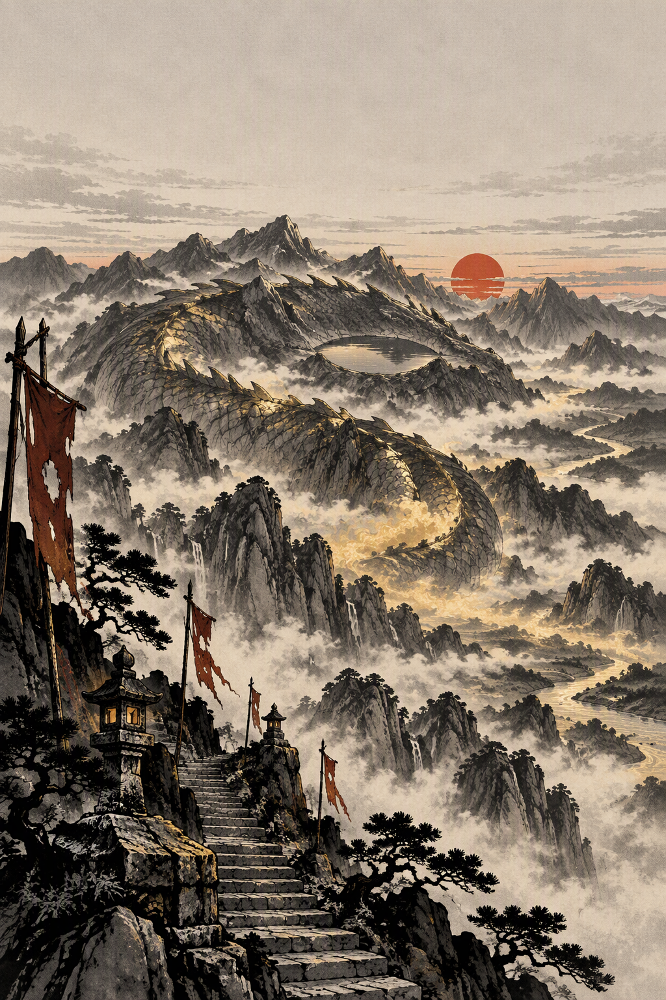

# JINLONG SHAN · 金龙山

一部日式漫画风格的东方奇幻连载：一座会翻身的山，一群还没定妆的人。



阅读站源码在 [`site/`](site/)，尚未部署；定妆与首话成图完成后上线。

## Logline

山是一条睡着的龙。它每百年翻一次身。这一次，它提前醒了。

## 故事

金龙山横亘千里。山下的人叫它山，山上的人叫它龙。它睡着，山脉是它的脊，矿脉是它的血，终年不散的金雾是它的呼吸。

每百年，龙换一次鳞。旧鳞落进山谷，城镇跟着山势搬家；换鳞之后，龙会翻身。翻身那夜，方圆千里的东西都会被抹平。

这一次，离换鳞还有一百天，龙却先做了噩梦。有人从它颈上撬走了一枚鳞——唯一一枚不能离体的逆鳞。山开始提前移动，栈道一夜改道，香客在山里一个接一个地失去名字。

一支来历各异的人被同一枚鳞片拴在一起：把它送回龙颈，山就还能再睡一百年。可逆鳞一旦离手，就会认新的主人；拿着它的人，能听见龙的心跳，也会一点一点被龙看见。

**四位主角尚未定妆。** 本文与设计圣经先锁定世界观、势力与画风；角色名、外观与配色等定妆完成后写入 [`assets/characters/design-bible.md`](assets/characters/design-bible.md)。

## 世界观

| 规则 | 内容 |
| --- | --- |
| 山即龙 | 山脉是龙的脊背。龙在故事的大部分时间里不许站起来，山体本身就是它的表演。 |
| 百年换鳞 | 每百年一次。旧鳞脱落、山体改道；换鳞之后是翻身，翻身即山崩。 |
| 金雾 | 山里的雾能让人看见未发生的事。吸得太久，会先忘记名字，再忘记脸。 |
| 逆鳞 | 长在龙颈，唯一不能离体的鳞。离体后认持有者为主；持有者听得见心跳，也会被龙看见。 |
| 龙心 | 山顶的心火。传说能实现一个愿望；守山一脉的规矩是「不能让任何人碰到」。 |
| 金鳞 | 离体仍在生长。金鳞司靠采鳞立国，山却因此病了。 |

## 势力

| 势力 | 立场 | 与主线的关系 | 视觉语言 |
| --- | --- | --- | --- |
| 金鳞司 | 朝廷的采鳞机构 | 想用逆鳞控制换鳞与翻身；追兵位出自这里 | 鎏金甲片、朱砂官印、整齐的仪仗 |
| 守山一脉 | 世代替龙守夜的人 | 不许任何人碰龙心；同行位可能出自这里 | 素麻、旧铜铃、被雾洗白的幡 |
| 拾鳞人 | 山下靠落鳞吃饭的人 | 主角团的来处；熟悉山的脾气，不熟悉山的秘密 | 补丁短打、拾鳞钩、蛇皮袋 |
| 无面香客 | 上山许愿的人 | 走得越深，越记不起自己；引路位可能出自这里 | 白布覆面、空白名牒、一步一叩 |

## Cast slots

角色名与设定图未定；以下只锁定叙事位置。

| 角色位 | Slug | 位置 | 定妆 |
| --- | --- | --- | --- |
| 主角位 | `lead` | 拾鳞人 · 持鳞者 · 第一个听见龙心跳的人 | 待定 |
| 同行位 | `partner` | 守山一脉，或叛出金鳞司的人 · 与主角争「送回还是使用」 | 待定 |
| 追兵位 | `rival` | 金鳞司执鳞官 · 相信控制换鳞才能保住山下的人 | 待定 |
| 引路位 | `guide` | 无面香客或老拾鳞人 · 带路收费，知道龙心在哪 | 待定 |
| 龙 | `dragon` | 非人形锚点 · 只以山脊、鳞层、雾与湖眼出现 | 待定 |

设定图、配色、不可改清单全部在 [`assets/characters/design-bible.md`](assets/characters/design-bible.md)。

## Visual style

- 日式少年漫画（shonen）质感：干净的黑墨线、网点纸阴影、赛璐璐上色、有限高饱和配色。
- 东方山岳奇幻：寺观、栈道、幡旗、石阶；龙是无翼蛇身的东方龙，不是西式有翼巨龙。
- 金色是叙事物：画面里只有龙气、逆鳞与金鳞允许用饱和金，其余颜色保持克制。
- 角色设定图统一为「左侧全身 + 右侧大头像 + 米白网点纸」的版式。
- 画面内不生成对白/标题文字，文字排版留到上字阶段。

## Repository layout

```
assets/characters/   角色定妆图（一致性基准）+ 设计圣经
assets/cover.png     氛围封面（不含角色）
comic/               正篇漫画分页与分镜脚本（pNN.png + pNN.md）
site/                在线阅读站（无构建，Cloudflare Pages 部署源）
```

## Roadmap

1. ✅ 仓库骨架、世界观、画风规范
2. ⬜ 四位主角 + 龙形锚点定妆
3. ⬜ 第一话分镜脚本（每页四格）
4. ⬜ 第一话成图
5. ⬜ 对白与拟声上字
6. ⬜ 阅读站部署

## 工作方式

见 [`AGENTS.md`](AGENTS.md)。流程固定为：**世界观 → 定妆 → 分镜 → 成图 → 上字**。每一步都以仓库文件为准，不以聊天记录为准。

## License

Artwork and text © the contributors. All rights reserved unless stated otherwise.
